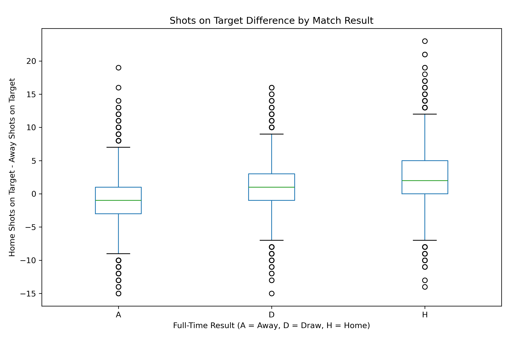
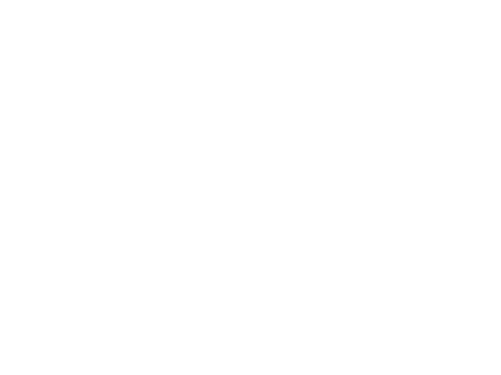
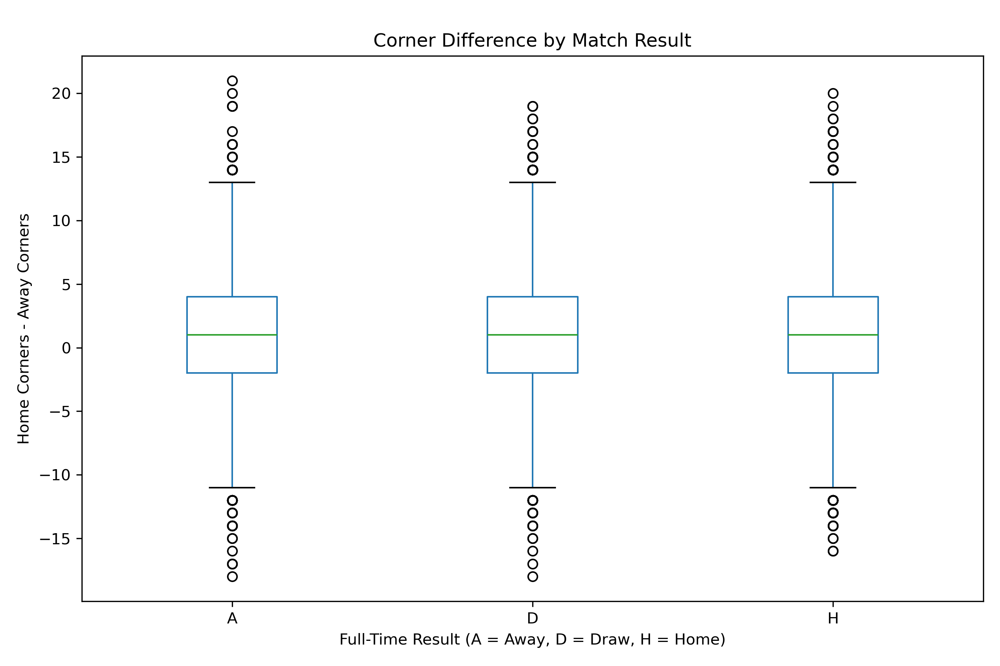
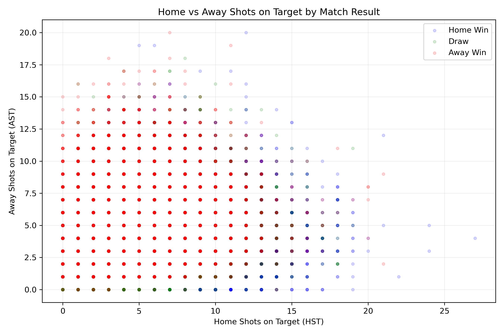

# Exploratory Data Analysis (EDA) Report

## 1. Introduction

The aim of this exploratory data analysis (EDA) is to investigate the
relationship between full-time football match statistics and match outcomes.

Our group's research question is:

**Can we predict the outcome of a Premier League match from the full-time statistics?**

This analysis focuses on three possible full-time results:

- H: Home Win
- D: Draw
- A: Away Win

Four visualisations were created to explore whether shooting statistics
and corner statistics are associated with match outcomes.

## 2. Dataset

The dataset was obtained from Football-Data.co.uk, which provides historical
football results and match statistics.

The project covers four English football divisions:

- Premier League (E0)
- Championship (E1)
- League One (E2)
- League Two (E3)

The project considers seasons from 2003/04 to 2025/26.

For this EDA, I used the shared football dataset stored in the group's
GitHub repository.

After selecting the required variables and removing rows with missing
values for the relevant analysis, 46,563 matches were included in
the visualisations.

The main variables used were:

| Variable | Description |
|----------|-------------|
| FTR | Full-Time Result |
| HS | Home Team Shots |
| AS | Away Team Shots |
| HST | Home Team Shots on Target |
| AST | Away Team Shots on Target |
| HC | Home Team Corners |
| AC | Away Team Corners |

## 3. Methodology

Python was used to perform the exploratory analysis.

The main libraries were:

- pandas: data manipulation and summary statistics
- matplotlib: data visualisation

Three difference variables were calculated:

1. Shots on Target Difference = HST - AST
2. Shot Difference = HS - AS
3. Corner Difference = HC - AC

Positive values indicate that the home team recorded more of the
corresponding statistic than the away team.

Negative values indicate that the away team recorded more.

Boxplots were used to compare these differences across match outcomes.

A scatter plot was also created to examine the relationship between
home and away shots on target.

The Python code is available in [EDA.py](EDA.py).

## 4. Exploratory Data Analysis

### 4.1 Figure 1: Shots on Target Difference by Match Result

Figure 1 compares the difference between home and away shots on target
across the three match outcomes.

The boxplot shows a relationship between shots on target difference
and match result.

Home wins generally have a positive shots on target difference,
while away wins tend to have a negative difference.

Draws are generally positioned between these two outcomes.

This suggests that the relative number of shots on target may be
an important variable when classifying match results.

However, the distributions overlap, indicating that shots on target
difference alone cannot perfectly distinguish between match outcomes.

### 4.2 Figure 2: Shot Difference by Match Result

Figure 2 examines the difference between total home shots and
total away shots.

The average shot differences were approximately:

| Match Result | Mean Shot Difference |
|--------------|----------------------|
| Away Win | 0.36 |
| Draw | 2.12 |
| Home Win | 3.78 |

Home wins were associated with a higher average shot difference.

However, the distributions overlap considerably.

This suggests that taking more shots than the opposition is associated
with match outcomes, but it does not guarantee a win.

### 4.3 Figure 3: Corner Difference by Match Result

Figure 3 compares corner difference across home wins, draws,
and away wins.

The average corner differences were approximately:

| Match Result | Mean Corner Difference |
|--------------|------------------------|
| Away Win | 1.11 |
| Draw | 1.16 |
| Home Win | 0.91 |

Unlike the shooting statistics, corner difference shows very similar
distributions across the three match outcomes.

The median corner difference is approximately one for each category.

This suggests that corner difference may have a weaker relationship
with match outcomes than shots or shots on target.

However, further analysis would be required to determine its
predictive importance.

### 4.4 Figure 4: Home vs Away Shots on Target

Figure 4 shows the relationship between home and away shots on target,
with points coloured according to the full-time result.

The horizontal axis represents home shots on target (HST),
while the vertical axis represents away shots on target (AST).

Home wins are more commonly associated with higher home shots on target
and lower away shots on target.

Away wins tend to show the opposite pattern.

However, the three match outcomes overlap considerably.

This indicates that matches with similar shooting statistics can
produce different results.

Because the dataset contains a large number of matches and shooting
statistics are discrete values, many observations overlap at the
same coordinates.

Therefore, the scatter plot should be interpreted as an exploratory
visualisation rather than a precise comparison of outcome frequencies.

## 5. Main Findings

The exploratory analysis suggests that:

1. Shots on target difference has a visible relationship with
   full-time match outcomes.

2. Total shot difference is also associated with match outcomes,
   although the distributions overlap.

3. Corner difference appears to have a weaker relationship with
   match outcomes than the shooting statistics.

4. Home and away shots on target may help distinguish match outcomes,
   but no single statistic is sufficient to classify every match correctly.

Overall, shooting statistics appear to be useful candidates for
further investigation in a classification model.

## 6. Limitations

There are several limitations to this exploratory analysis.

First, the data covers multiple football divisions and seasons.
Relationships may differ between leagues and over time.

Second, some variables contain missing values.
Rows with missing values in the variables required for a particular
visualisation were excluded.

Third, the boxplots and scatter plot show associations rather than
causal relationships.

Finally, the statistics used in this analysis are recorded during
or after the match.

Therefore, a model using these variables would classify match
outcomes from full-time statistics rather than predict results
before kick-off.

## 7. Next Steps

The next stage of the project is to investigate whether the observed
relationships can be used in a classification model.

A Decision Tree classifier is a possible baseline model.

The proposed approach is to:

- Train the model using Championship, League One and League Two data.
- Test the model using Premier League data.
- Evaluate performance using accuracy and a confusion matrix.
- Investigate which match statistics are most informative.

Full-time goals (FTHG and FTAG) should not be included as predictors
because they directly determine the full-time result and would
introduce target leakage.

## 8. Resources

### Data Source

Football-Data.co.uk

https://football-data.co.uk/data.php

This website provides historical football results and match statistics
used in the project.

### Python Documentation and Code Examples

pandas: Chart Visualisation

https://pandas.pydata.org/docs/user_guide/visualization.html

Matplotlib: Boxplot Examples

https://matplotlib.org/stable/gallery/statistics/boxplot_demo.html

These resources provide examples of Python visualisation techniques.
The project's own Python code is available in EDA.py.

Any specific example code adapted from these resources should be
identified when documenting the final code-development process.

## 9. Conclusion

This EDA investigated the relationship between full-time match
statistics and football match outcomes.

The results suggest that shooting statistics, particularly shots
on target difference, are associated with match results.

Corner difference appears less useful for distinguishing between
home wins, draws and away wins.

These findings provide a starting point for further modelling and
evaluation of match outcome classification.
