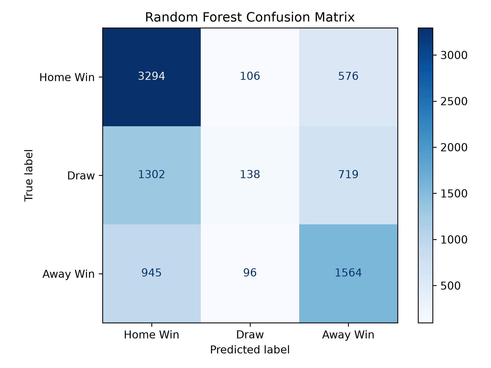
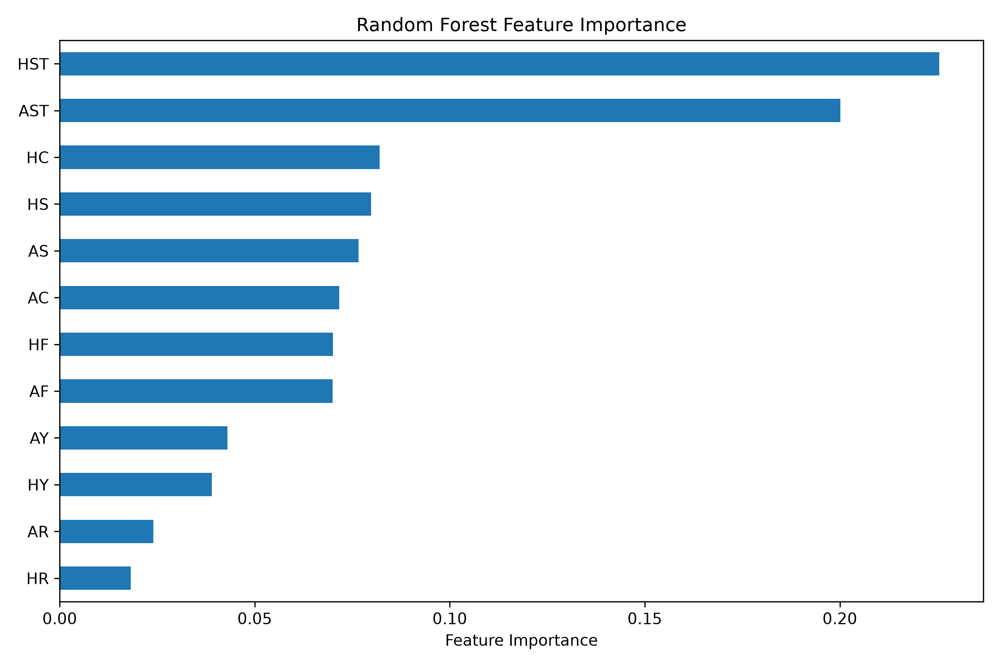

# Random Forest Classification Report

## 1. Introduction

The aim of this project is to investigate whether full-time
football match statistics can be used to classify match outcomes.

The research question is:

**Can we predict the outcome of a Premier League match from the full-time statistics?**

A Random Forest classifier was developed to classify football
matches into three possible outcomes:

- H: Home Win
- D: Draw
- A: Away Win

Random Forest was selected because it combines multiple decision
trees and can capture complex relationships between different
match statistics.

This report presents the model development process, evaluation
results, feature importance, and limitations.

## 2. Dataset

The dataset contains historical English football match statistics
obtained from Football-Data.co.uk.

The project includes data from four English football divisions:

- Premier League
- Championship
- League One
- League Two

The processed training and testing datasets were provided by
a group member and stored in the GitHub repository.

The following files were used:

- `processed-data/football_train_data.csv`
- `processed-data/football_test_data.csv`

The datasets contain:

| Dataset | Number of Matches |
|---------|------------------:|
| Training Dataset | 37,824 |
| Testing Dataset | 8,740 |
| Total | 46,564 |

The training and testing datasets were used as provided,
without creating an additional random split.

The target variable was `FTR`, representing the full-time result.

## 3. Feature Selection

Twelve full-time match statistics were selected as input features.

| Feature | Description |
|---------|-------------|
| HS | Home Team Shots |
| AS | Away Team Shots |
| HST | Home Team Shots on Target |
| AST | Away Team Shots on Target |
| HF | Home Team Fouls |
| AF | Away Team Fouls |
| HC | Home Team Corners |
| AC | Away Team Corners |
| HY | Home Team Yellow Cards |
| AY | Away Team Yellow Cards |
| HR | Home Team Red Cards |
| AR | Away Team Red Cards |

These variables describe attacking performance, fouls,
corners, and disciplinary statistics.

The target variable `FTR` was excluded from the input features.

Full-time goals (`FTHG` and `FTAG`) were also excluded because
they directly determine the final match result.

Including these variables would introduce target leakage.

Betting odds were not included because this model focuses
on the relationship between match statistics and outcomes.

## 4. Methodology

### 4.1 Data Preprocessing

Python was used to develop the Random Forest model.

The main libraries were:

- pandas
- matplotlib
- scikit-learn

The training and testing datasets were loaded using pandas.

The selected input features were converted to numeric values.

Rows without valid target labels were excluded.

Missing feature values were handled using median imputation.

The imputer was fitted using the training data and then
applied to the testing data.

This prevents information from the test set from being
used to calculate the replacement values.

### 4.2 Random Forest Model

A Random Forest classifier was implemented using scikit-learn.

The model parameters were:

| Parameter | Value |
|-----------|-------|
| Number of Trees | 200 |
| Maximum Tree Depth | 12 |
| Random State | 42 |
| Parallel Processing | n_jobs=-1 |

Random Forest combines predictions from multiple decision trees.

Each tree learns patterns from the training data, and the
final classification is determined by the ensemble.

The model was trained using the training dataset and evaluated
on the separate testing dataset.

The implementation is available in
[RandomForest.py](RandomForest.py).

## 5. Model Evaluation

### 5.1 Accuracy

The Random Forest model achieved an overall test accuracy of:

**Accuracy = 57.16%**

This means that approximately 57% of the test matches
were classified correctly.

The accuracy was calculated as:

Accuracy = Correct Predictions / Total Predictions

The model correctly classified 4,996 out of 8,740
test matches.

Although the model performs better than always predicting
the most common test-set outcome, accuracy alone does
not fully describe its performance.

Therefore, precision, recall, F1-score, and a confusion
matrix were also examined.

### 5.2 Classification Report

The classification results were:

| Match Result | Precision | Recall | F1-score |
|--------------|----------:|-------:|---------:|
| Home Win | 0.59 | 0.83 | 0.69 |
| Draw | 0.41 | 0.06 | 0.11 |
| Away Win | 0.55 | 0.60 | 0.57 |

The overall accuracy was 0.57.

The macro-average F1-score was approximately 0.46.

The model performed best when identifying home wins.

Home wins achieved a recall of approximately 83%,
meaning that most actual home victories were correctly
identified.

Away wins achieved a recall of approximately 60%.

However, draws achieved a recall of only approximately 6%.

This indicates that the model struggled to identify
drawn matches.

## 6. Confusion Matrix

The confusion matrix compares actual match outcomes
with the model's predictions.

| Actual / Predicted | Home Win | Draw | Away Win |
|--------------------|---------:|-----:|---------:|
| Home Win | 3294 | 106 | 576 |
| Draw | 1302 | 138 | 719 |
| Away Win | 945 | 96 | 1564 |

The model correctly predicted:

- 3,294 home wins
- 138 draws
- 1,564 away wins

The confusion matrix reveals that the model frequently
classified drawn matches as home wins or away wins.

Of the 2,159 actual draws, only 138 were correctly
identified.

In comparison, 1,302 draws were incorrectly classified
as home wins, while 719 were classified as away wins.

This suggests that the model has difficulty distinguishing
draws from matches with a winning team.

The model also shows a tendency to predict home wins
more frequently than draws.

## 7. Feature Importance

Feature importance was examined to investigate which
variables contributed most to the model's decisions.

The two most important features were:

1. HST: Home Shots on Target
2. AST: Away Shots on Target

Other relevant features included:

- HC: Home Corners
- HS: Home Shots
- AS: Away Shots
- AC: Away Corners

The feature importance results suggest that shooting
accuracy is particularly informative when classifying
football match outcomes.

This finding is consistent with the earlier EDA,
which showed a visible relationship between shots
on target difference and match outcomes.

However, feature importance does not establish causation.

Furthermore, the importance values describe the
model's use of the variables rather than the
independent predictive power of each statistic.

## 8. Baseline Comparison

To provide context for the Random Forest accuracy,
a simple majority-class baseline was considered.

The most common outcome in the test dataset was
a home win.

A classifier that always predicted a home win
would achieve:

Baseline Accuracy = 3976 / 8740

**Baseline Accuracy = 45.49%**

The Random Forest achieved 57.16%, approximately
11.67 percentage points higher than this baseline.

This suggests that the Random Forest extracts useful
information from the selected match statistics.

However, further comparisons with other classifiers
would be required to assess its relative performance.

## 9. Limitations

The Random Forest model has several limitations.

First, the model performs poorly when identifying draws.
Its draw recall is approximately 6%, indicating that
most drawn matches are misclassified.

Second, the training dataset contains more home wins
than draws or away wins.

This class imbalance may contribute to the model's
tendency to predict home victories.

Third, the model uses only twelve selected match statistics.
Other variables may contain useful information.

Fourth, the model parameters were selected as an initial
configuration rather than through systematic
hyperparameter optimisation.

Fifth, the processed datasets were supplied by a group
member. The exact splitting procedure should be confirmed
before making claims about performance across leagues
or seasons.

Finally, the input variables are full-time match statistics.

Therefore, this model performs retrospective match outcome
classification rather than prediction before kick-off.

## 10. Possible Improvements

Several improvements could be investigated.

One approach is to address class imbalance using
class weights.

For example, the Random Forest classifier supports
the parameter:

`class_weight="balanced"`

This may improve the identification of draws,
although it does not guarantee better performance.

Another approach is hyperparameter tuning,
including adjusting:

- Number of trees
- Maximum tree depth
- Minimum samples per leaf
- Maximum features considered at each split

Additional evaluation metrics, particularly
macro-average F1-score and draw recall,
should be considered alongside accuracy.

Hyperparameters should be selected using validation
within the training data rather than repeatedly
optimising against the test set.

## 11. Conclusion

This project developed a Random Forest classifier
using twelve full-time football match statistics.

The model achieved an accuracy of 57.16% on
8,740 test matches.

The results indicate that Random Forest can identify
relationships between match statistics and match outcomes.

Home wins were classified relatively successfully,
while draws remained difficult to identify.

Feature importance analysis showed that home and away
shots on target were the most influential variables
in the model.

Overall, the model provides a useful initial benchmark
for football match outcome classification.

Future work should focus on improving draw classification,
evaluating alternative models, and validating performance
across different leagues and seasons.

## 12. References

Football-Data.co.uk:
https://football-data.co.uk/data.php

Scikit-learn Random Forest Classifier:
https://scikit-learn.org/stable/modules/generated/sklearn.ensemble.RandomForestClassifier.html

Scikit-learn Classification Metrics:
https://scikit-learn.org/stable/modules/model_evaluation.html

Scikit-learn Feature Importance:
https://scikit-learn.org/stable/auto_examples/ensemble/plot_forest_importances.html
